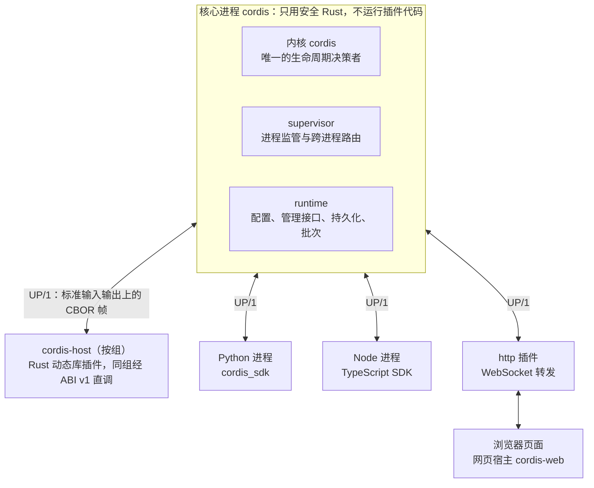

# Rust-Cordis

一个能在运行中替换任何语言插件的组件运行时。

内核实现论文《一种面向时空可组合性的编程范式》定义的模型：组件贡献的每个效应都可以回退，组件依赖的服务变化时自动重建。在内核之上，Rust-Cordis 扩展出一个跨进程、跨语言的插件平台：Rust、Python、TypeScript 写的插件，以及浏览器页面，都以同样的方式装载、组合、热替换和回滚。核心进程不运行任何插件代码，任何插件崩溃都不会波及内核。

> Rust-Cordis is a component runtime that hot-swaps plugins written in any language while they run. Its kernel implements the spatiotemporal composability model of the [cordis](https://github.com/cordiverse/cordis) paper: every effect is reversible, and components rebuild themselves when the services they depend on change. On top of the kernel sits a cross-process, cross-language plugin platform. The core process never executes plugin code, so no plugin crash can reach the kernel.

## 能力

| 能力 | 说明 | 依据 |
|---|---|---|
| 可回退的组件 | 组件停用、重载或失败时，内核按相反顺序归还它占用过的一切：监听器、服务、子组件、任意资源 | [语义规格](docs/01-semantics.md) |
| 反应式服务 | 服务出现时依赖方加载，被替换时重载，消失时卸载；提供方卸载前，依赖方先完成清理 | [DOC-01](docs/01-semantics.md) |
| 热替换不丢状态 | 冻结旧实例、导出状态、新实例继承状态；候选失败时自动回滚到原版本和原状态 | [插件模型](docs/11-plugin-model.md) |
| 批量替换 | 多个插件作为一个事务替换，全部成功才生效 | [ADR-0031](docs/adr/0031-batch-replacement.md) |
| 崩溃隔离 | 插件跑在独立进程中；panic、段错误、栈溢出、死循环都只影响所在进程，核心负责重启 | [ADR-0018](docs/adr/0018-core-isolation.md) |
| 任何语言 | 核心与插件之间使用语言无关的 UP/1 协议；Rust、Python、TypeScript SDK 与浏览器宿主均已接入 | [DOC-16](docs/16-up1-protocol.md) |
| 原生高速调用 | 同组 Rust 插件经冻结的 ABI v1.0 直接调用，单次约 19 ns | [DOC-12](docs/12-abi-v1.md) |
| 一份接口，三种语言 | 用 WIT 描述接口，生成 Rust、Python、TypeScript 绑定 | [ADR-0039](docs/adr/0039-wit-bindings.md) |
| HTTP 与大文件 | 普通插件登记 HTTP 路由；同一端口服务页面、WebSocket 和外部 API；通用字节流按需传输文件 | [ADR-0046](docs/adr/0046-http-routes.md) |
| 可信调用身份 | 核心报告后端实例或页面来源，插件据此授权；官方密钥插件按实例授予读取权限 | [使用指南](docs/guide.md#通用字节流与调用来源) |
| 契约验证 | 插件在隔离的核心中跑完接口契约套件才获准装载 | [DOC-11](docs/11-plugin-model.md) |
| 交付 | 打包成压缩包或 macOS `.app`，或安装为 launchd、systemd 服务 | [ADR-0036](docs/adr/0036-release-packaging.md) |

## 架构



图中浏览器页面已在 M20 接入。

只有一个内核，它在核心进程里。实例、依赖、加载卸载、替换与回滚都由它决定。插件进程和网页宿主只执行核心的指令，不含内核。

插口有两种：

- **高速插口**：Rust 插件编译成动态库，由 `cordis-host` 按 `cordis.toml` 中的 `group` 装载。同组插件经 ABI v1 直接调用；热替换时整组宿主进程换新，不卸载动态库。
- **通用插口**：任何能读写标准输入输出、能编解码 CBOR 的语言都能写插件。跨进程调用使用对象的通用入口 `invoke`，参数为方法名和 CBOR 数据。

核心之外一切皆插件。目录监视（`watch`）、日志输出（`console-log`）、HTTP、桌面窗口都是普通插件。运行中的装载、替换、回滚由持有 `cordis.manage@1` 授权的插件发起，授权只写在 `cordis.toml`。

仓库中的代码分三层，各层知道的事情不同：

| 层 | 位置 | 掌握的事实 |
|---|---|---|
| 内核 | `crates/cordis` | 实例、依赖、生命周期、替换与回滚 |
| 核心进程的其他部分 | `crates/cordis-supervisor`、`cordis-routing`、`cordis-channels`、`cordis-web-deployment`、`cordis-runtime` 等 | 进程与连接、消息路由、调用来自哪个实例和哪个页面 |
| 官方插件 | `plugins/` | HTTP、密钥、目录监视、窗口等各自领域的语义 |

`plugins/` 中的插件随发布包交付，方便开箱即用。它们与内核的关系和用户自己写的插件相同：内核不认识也不依赖它们，从 `cordis.toml` 中移除后核心照常运行。HTTP 的请求头与 Cookie、密钥的内容与授权规则，只出现在对应插件中；核心转交这些数据，但不解析、不保存。

核心向服务提供方标明调用来自哪个实例（`cordis.caller`）。这对应上游 cordis 内核已有的语义：服务经 `symbols.caller` 取得调用方上下文，上游的日志服务就靠它在每条日志前标出来源插件（`cordis/packages/core/src/utils.ts`、`logger.ts`）。上游的插件都在同一进程，本项目的插件分布在多个进程，因此由核心把这项信息带过进程边界。

## 设计原则

| 原则 | 内容 | 决策 |
|---|---|---|
| Q0 核心隔离 | 核心进程不运行插件代码，不链接 `cordis-abi`、`cordis-sdk`；核心全部 crate 无 `unsafe`，每个里程碑审计 | [ADR-0018](docs/adr/0018-core-isolation.md) |
| 唯一内核 | 内核只在核心进程中存在一份，所有插件进程共享同一棵组件树 | [DOC-13](docs/13-runtime-architecture.md) |
| 两种插口 | 原生动态库追求速度，进程协议追求通用，两者接入同一个内核 | [ADR-0019](docs/adr/0019-two-sockets.md) |
| 一切皆插件 | 核心只含 `run`、`status`、`service`、`version`；开发工具是独立程序 `cordis-dev` | [ADR-0024](docs/adr/0024-everything-else-is-a-plugin.md) |
| 跨进程组合 | 隔离域、拦截元数据、子组件装入都可以跨进程使用 | [ADR-0025](docs/adr/0025-cross-process-composition.md) |
| 前端也是插件 | 每个浏览器页面是一个独立连接，页面上的组件在核心中有对应的子实例 | [ADR-0023](docs/adr/0023-frontend-plugins.md) |
| ABI 冻结 | ABI v1.0 在 M11 冻结，布局只随 ADR 改变；不同 Rust 编译器版本编出的插件可以互相替换 | [DOC-12](docs/12-abi-v1.md)、[布局](docs/abi/v1-layout.txt) |
| 行数预算 | 每个核心 crate 有代码行上限，内核上限 6000 行；超出须先拆分并写 ADR | [DOC-13](docs/13-runtime-architecture.md) |

## 实测

以下数据来自 Apple Silicon macOS（14 核，48 GiB），原始样本保存在 [`docs/measurements`](docs/measurements)。

| 场景 | 结果 | 来源 |
|---|---|---|
| 规模启动 | 8 个独立插件库、100 个实例在 6139 ms 内全部进入 Active | [M14 验收](docs/measurements/m14-acceptance.md) AC-1 |
| 并发替换 | 8 个线程持续调用，连续 50 次原生替换，每轮版本与状态都正确 | [M14 验收](docs/measurements/m14-acceptance.md) AC-9 |
| 替换停顿 | 中位数 241 ms，最大 661 ms | M14 RM-4 |
| 同组直接调用 | 中位数 18.6 ns | M14 RM-9 |
| 每次替换的核心内存增量 | 27.84 KiB | M14 RM-6 |
| 故障隔离 | panic、段错误、栈溢出、abort、死循环、超大帧、畸形 CBOR、请求洪泛均被隔离，其他分组继续运行 | M14 AC-7、AU-2 |
| 跨编译器替换 | Rust 1.96 编译的插件替换为 Rust 1.85 编译的版本，计数连续 | M14 AC-8 |
| 核心恢复 | launchd 托管的核心被 SIGKILL 后 1038 ms 恢复全部插件，状态取自检查点 | [M15](docs/measurements/m15-core-recovery.json) RM-10 |
| 窗口进程恢复 | 桌面窗口进程被 SIGKILL 后 875 ms 恢复，核心进程不变 | [M16](docs/measurements/m16-window-recovery.json) |
| 跨语言迁移 | 原生 kv → Python kv → 失败候选回滚 → 原生 kv → 批次替换，计数依次为 1、99、200、255、366 | [M18](docs/measurements/m18-python-sdk.json) |
| Python 契约 | Python 版 kv 通过原生 kv 的全部 8 项契约断言 | [M18](docs/measurements/m18-python-sdk.json) |
| 网页与全栈替换 | 两页独立状态保留，Rust→Python 后端切换与坏前端候选回退通过；三语言提供方撤回使页面 Pending，插回后恢复 | [M20 浏览器验收](docs/measurements/m20-web-acceptance.json) |
| 页面故障隔离 | 超大帧、畸形 CBOR、嵌套转发及 128 个并发调用只关闭故障页；健康页面和核心身份保持 | M20 AU-15 |
| 通道解析 | 固定 1800 秒模糊测试，实际 1801 秒、1,663,834 次输入，退出 0 | [M20 UP/1](docs/measurements/m20-up1-fuzz.json) |
| 跨进程完整调用 | 原生 Rust→Rust / Python / TypeScript 各 10000 次，64 字节 get 的中位数 124.833 / 116.875 / 81.375 µs，99 分位 237.750 / 146.125 / 175.084 µs | [M21 RM-7](docs/measurements/m21-performance/README.md) |
| 第三阶段同组调用 | 原正式实现停载轮中位数 19.36792 ns，基线 20.22250 ns；比值 0.95774，通过原 1.05 判据，首轮负载重叠结果与全部样本一并保留 | M21 RM-9 |
| 完整解释器发布 | 移动后的签名 tar 包运行 Python 3.12.16、Node 22.23.5 与原生 CBOR 扩展，真实 KV 调用及所有进程退出通过 | [M21 发布记录](docs/measurements/m21-script-runtimes.json) |
| HTTP 路由往返 | Rust / Python / TypeScript 各 10000 次 GET，中位数 472.3 / 401.0 / 348.4 µs，P99 611.8 / 478.3 / 451.7 µs | [M22 RM-11](docs/measurements/m22-latency.json) |
| 大文件传输 | 三语言各 64 MiB 上传与下载逐字节一致；HTTP 常驻内存增量 9,682,944 字节 | [M22 传输记录](docs/measurements/m22-files.json) |
| 上游一致性 | 177 条上游用例：8 条移植、166 条改写、3 条不适用，每个里程碑重新校验 | [一致性矩阵](docs/04-conformance.md) |

## 快速开始

需要 Rust 1.96.0（`rust-toolchain.toml` 自动选择）。Python 插件需要 Python 3.11 以上和 `cbor2`。

```bash
cargo build --release --target-dir target -p cordis-runtime -p cordis-host -p cordis-dev
export PATH="$PWD/target/release:$PATH"

cordis new demo && cd demo
cordis new-plugin hello --rust       # Rust 原生插件
cordis new-plugin greeter --python   # Python 进程插件
python -m pip install --target plugins/greeter/.dependencies -r plugins/greeter/requirements.txt
cargo build --target-dir target
cordis run
```

另开终端执行 `cordis status` 查看实例。修改 `plugins/hello/src/lib.rs` 后重新 `cargo build`，或者直接修改 Python 插件源码，`watch` 插件会把变化提交给核心热替换；新版本失败时自动回到原版本和原状态。

内核接口、契约验证、服务部署、发布打包、WIT 生成和 Python 依赖安装的完整说明见 [使用指南](docs/guide.md)。插件编写手册见 [cordis-plugin skill](skills/cordis-plugin/SKILL.md)。

## 组成

代码行只计代码，不含注释和空行，由 `tools/source_lines.py` 统计。

| 部分 | 代码行 | 职责 |
|---|---:|---|
| `crates/cordis` | 4230 | 内核：上下文、效应、事件、服务、纤程与组件生命周期 |
| `crates/cordis-supervisor` | 5445 | 插件进程监管、页面上下文、批量替换与可信调用身份 |
| `crates/cordis-routing` | 736 | 对象出口、资源转交、协议描述符与元数据额度 |
| `crates/cordis-channels` | 250 | 独立页面连接与有界转发队列 |
| `crates/cordis-web-deployment` | 870 | 网页资源、页面子实例、来源标识与全栈事务 |
| `crates/cordis-runtime` | 5400 | 核心可执行程序 `cordis`：配置、授权、管理接口、持久化、状态发布 |
| `crates/cordis-up` | 1628 | UP/1 协议编解码 |
| `crates/cordis-process`、`cordis-types` | 579 | 进程控制与共享类型 |
| 核心九个 crate 合计 | 19138 | |
| `crates/cordis-host` | 2730 | 原生插件宿主进程 |
| `crates/cordis-abi` | 2407 | ABI v1.0 的布局与调用约定；`unsafe` 只出现在 ABI、原生宿主和 SDK 宏中，位置由审计测试约束 |
| `crates/cordis-sdk`、`cordis-sdk-macros` | 2407 | Rust 插件 SDK、动态调用与过程宏 |
| `crates/cordis-idl` | 2331 | WIT 解析与三语言绑定生成 |
| `crates/cordis-dev` | 2580 | 开发工具：`new`、`new-plugin`、`idl gen`、`verify`、`pack` |
| `sdks/python` | 967 | Python SDK |
| `sdks/typescript` | 1501 | 共用 SDK 1294 行、网页宿主 207 行，统计各自 src |
| `plugins/` | | `watch`、`console-log`、`http`、`window`、`secrets`；三语言 HTTP 回显和 KV、计数示例；共享接口与契约包括 `http-api`、`stream-api`、`secrets-api`、`kv-api`、`kv-contract`、`web-api`、`forward-api`、`window-api` |

## 理论依据

| 代号 | 对象 | 角色 |
|---|---|---|
| `PAPER` | 论文《一种面向时空可组合性的编程范式》§3、§4.1、§5.3 | 规范：模型定义、核心库的六个算法、术语 |
| `UPSTREAM` | [cordiverse/cordis](https://github.com/cordiverse/cordis) `packages/core`，commit `261c5fd` | 参考实现；177 条 vitest 用例是行为依据 |

两者矛盾时以论文为准并写 ADR；论文未覆盖的细节以上游为准。上游的 `loader`、`hmr`、`create`、`logger-console` 作为插件平台的行为参考，只参考行为与配置语义，不移植代码。

上游是 TypeScript，插件以 `import()` 装进同一个 Node 进程，热替换依靠重新导入和垃圾回收。Rust 没有稳定的二进制接口，也不能安全卸载已装载的代码，原生代码的崩溃会带走整个进程。插件平台的 ABI、宿主进程、UP/1 协议与进程监管，是在 Rust 中提供同等能力并加上崩溃隔离所需的结构，设计见 [DOC-10](docs/10-evolution-strategy.md) 至 [DOC-16](docs/16-up1-protocol.md)。

## 路线图

| 阶段 | 里程碑 | 内容 | 状态 |
|---|---|---|---|
| 一：内核 | M0–M6 | 上下文与效应、事件、组件生命周期、反应式服务、拦截与替换、多线程验收 | 完成 |
| 二：插件平台 | M7–M9 | 拥有型名称、ABI、Rust SDK 与通用调用 | 完成 |
| | M10–M11 | UP/1 与进程监管；原生宿主、组内替换、跨进程组合；ABI v1.0 冻结 | 完成 |
| | M12–M13 | 核心可执行程序、管理接口、批量替换、watch、脚手架；独立契约验证 | 完成 |
| | M14–M15 | 系统验收与可替换性测量；插件编写手册与系统服务 | 完成 |
| 三：通用插口 | M16 | 发布压缩包与 `.app`、HTTP 入口、独立窗口进程 | 完成 |
| | M17 | WIT 三语言接口生成 | 完成 |
| | M18 | Python SDK 与跨插口双向替换 | 完成 |
| | M19 | TypeScript SDK、`kv-ts`、`new-plugin --ts` | 完成 |
| | M20 | 前端插件与全栈插件：WebSocket 转发、页面子实例、网页宿主 `cordis-web` | 完成 |
| | M21 | 多语言全栈总验收、完整 Python/Node 发布包与插件编写手册 | 完成 |
| 追加 | M22 | HTTP 路由、通用字节流、页面调用来源与密钥插件 | 完成；[v0.1.0](https://github.com/Proton1917/Rust-Cordis/releases/tag/v0.1.0) 已发布 |
| | M23 | SDK 动态调用、拥有型资源与命名依赖 | 专项通过；固定 Git 验收在推送后执行 |

每个里程碑一个提交，须通过格式、clippy、全部测试（M18 时 307 条）、177 条一致性矩阵、`unsafe` 审计和行数预算检查。逐项记录见 [PROGRESS](docs/PROGRESS.md)，各阶段验收摘要见 [使用指南](docs/guide.md#里程碑验收摘要m0m18)。

## 文档

| 文件 | 内容 |
|---|---|
| [`docs/guide.md`](docs/guide.md) | 使用指南：内核接口、构建、插件编写、验证、部署、打包、WIT、Python |
| [`docs/00-strategy.md`](docs/00-strategy.md) – [`04`](docs/04-conformance.md) | 第一阶段：战略、语义规格、Rust 架构、路线图、一致性矩阵 |
| [`docs/10-evolution-strategy.md`](docs/10-evolution-strategy.md) | 第二阶段战略：常驻运行时与独立演化的插件 |
| [`docs/11-plugin-model.md`](docs/11-plugin-model.md) | 插件模型：契约、资源规则、状态迁移与热替换 |
| [`docs/12-abi-v1.md`](docs/12-abi-v1.md) | 原生插件二进制接口 ABI v1 |
| [`docs/13-runtime-architecture.md`](docs/13-runtime-architecture.md) | 运行时架构：crate 划分、行数预算、插件进程 |
| [`docs/14-roadmap-phase2.md`](docs/14-roadmap-phase2.md) | 第二阶段路线图与退出条件 |
| [`docs/15-universal-socket.md`](docs/15-universal-socket.md) | 核心隔离与两种插口，M9–M21 的里程碑定义 |
| [`docs/16-up1-protocol.md`](docs/16-up1-protocol.md) | UP/1 通用插件通信协议 |
| [`docs/adr/`](docs/adr) | 决策记录 |
| [`docs/measurements/`](docs/measurements) | 验收与测量的原始数据 |
| [`docs/explainer/`](docs/explainer/index.html) | 图解说明页 |
| [`skills/cordis-plugin/SKILL.md`](skills/cordis-plugin/SKILL.md) | 插件编写手册与模板 |
| [`docs/PROGRESS.md`](docs/PROGRESS.md) | 进度日志 |
| [`AGENTS.md`](AGENTS.md) | 实现者的工作规则 |

## 许可证

MIT，与上游 cordis 一致，全文见 `LICENSE`。本仓库的设计与测试用例参照 [cordiverse/cordis](https://github.com/cordiverse/cordis)（MIT，Copyright (c) 2021-present Shigma），其版权声明保留在 `LICENSE` 中。
